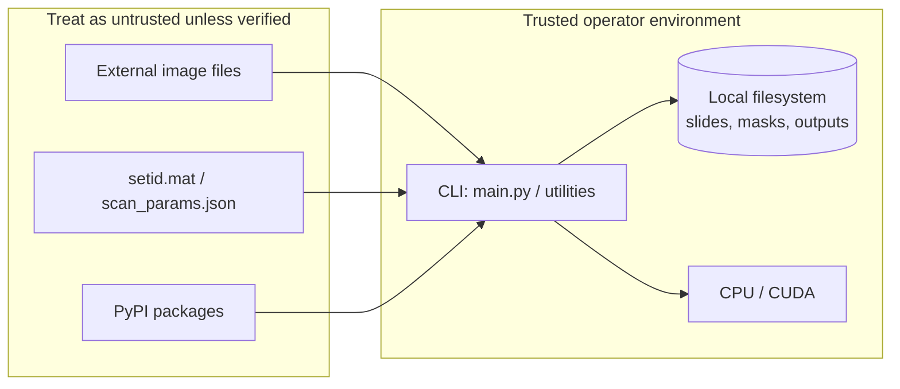

# Security Policy — IEM Code (Morphle / Robotome)

This document describes how to report security issues in this repository, the security model of the **Inpainting Error Maximization (IEM)** batch pipeline, and recommended practices for developers and operators. It is informed by a review of this codebase and industry guidance including [OWASP Top 10 (2025)](https://owasp.org/www-project-top-ten/), [NIST SP 800-218 SSDF](https://nvlpubs.nist.gov/nistpubs/SpecialPublications/NIST.SP.800-218.pdf), [OWASP ML Security Top 10 (draft)](https://owasp.org/www-project-machine-learning-security-top-ten/), and related references listed at the end.

---

## Reporting a vulnerability

**Please do not open a public GitHub issue for security vulnerabilities.**

Report suspected security issues privately so they can be triaged and fixed before public disclosure:

| Channel | Details |
| --- | --- |
| **GitHub** | [Private vulnerability reporting](https://docs.github.com/en/code-security/security-advisories/working-with-repository-security-advisories/about-repository-security-advisories) on `morphiens/iem-code` (preferred when enabled) |
| **Email** | Contact the Morphle / Robotome maintainers through your organization's established security or engineering channel |

### What to include in a report

- Affected component (e.g. `main.py`, `datasets.py`, dependency name and version)
- Steps to reproduce, including sample command lines and environment (OS, Python, PyTorch)
- Impact assessment (confidentiality, integrity, availability)
- Proof of concept if available (keep PHI and patient data out of reports)

### Our response expectations

| Milestone | Target |
| --- | --- |
| Acknowledgment | Within **5 business days** |
| Initial triage | Within **10 business days** |
| Critical fixes | As soon as practicable; aim for **30 days** for issues affecting production PHI workflows |
| Coordinated disclosure | We will agree on a publication date with reporters and credit discoverers unless they prefer anonymity |

Practices align with [GitHub coordinated disclosure guidance](https://docs.github.com/en/code-security/concepts/vulnerability-reporting-and-management/coordinated-disclosure) and [maintainer vulnerability reporting workflows](https://github.blog/security/vulnerability-research/a-maintainers-guide-to-vulnerability-disclosure-github-tools-to-make-it-simple/).

### Supported versions

| Version / branch | Security updates |
| --- | --- |
| `main` (latest on GitHub) | Yes — active development |
| Unreleased local forks | Maintainer discretion |
| Archived snapshots | No |

There is no formal semver release line today; security fixes land on `main`.

---

## Executive summary

**IEM Code** is an offline **Python / PyTorch** research and production-adjacent pipeline for image segmentation via inpainting error maximization, extended for **Morphle** whole-slide and pre-processed microscopy imagery. It is **not** a network service: there is no HTTP API, authentication layer, or multi-tenant runtime in this repository.

Primary security concerns for deployments that use this repo are:

1. **Protection of pathology imagery and metadata** (often PHI under HIPAA / comparable regimes).
2. **Filesystem trust** — all inputs are local paths and globs; misuse can read or overwrite sensitive files if the OS user is over-privileged.
3. **Denial of service** via large or malicious images and heavy tensor workloads.
4. **Supply chain** — unpinned dependencies (PyTorch, Pillow, SciPy, OpenCV, scikit-learn) and absence of a committed lockfile in this repo.
5. **Integrity of segmentation outputs** used downstream for labelling, QC, or clinical-adjacent workflows.

---

## System architecture and trust boundaries

| Boundary | Inside (trusted) | Outside (verify / restrict) |
| --- | --- | --- |
| Process | Batch jobs run by authorized lab or research staff | Arbitrary shell users on shared machines |
| Data | De-identified or access-controlled slide trees | Public datasets, unvetted downloads, internet-hosted weights |
| Network | Typically none for this repo | Future CI, package indexes, cloud sync |

### Components (code map)

| File | Role | Security-relevant behavior |
| --- | --- | --- |
| `main.py` | IEM driver | CLI `data_path`, glob-based dataset loading, writes under `../../Data/Output` and `../../Data/Output_Results` |
| `datasets.py` | Image / mask loaders | `PIL.Image.open`, `scipy.io.loadmat` (Flowers), path parsing for Morphle layout |
| `models.py` | Gaussian inpainting modules | No pickled checkpoints in-repo; in-memory tensors only |
| `utils.py` | LAB color I/O | Writes PNG via Pillow |
| `metrics.py` | Segmentation metrics | Pure tensor math |
| `dbscan.py` | Clustering utility | Reads images, writes `labels.jsonl` and PNGs under `../../Output` |
| `generate_labelling_jobs.py` | Organize outputs by tissue type | Reads `scan_params.json`, moves files with `shutil.move` |
| `get_files_by_tissue_type.py` | Index slides by specimen type | Aggregates paths into `slides_by_tissue_type.json` |

---

## Data classification and compliance

When this pipeline processes **Morphle slide data**, assume **PHI and sensitive clinical metadata** unless a formal de-identification and legal review says otherwise.

### Minimum expectations (operators)

Align with [imaging research security practice](https://pmc.ncbi.nlm.nih.gov/articles/PMC3491152/) and [medical image de-identification guidance](https://arxiv.org/pdf/2303.10473v3.pdf):

- Run jobs only on **access-controlled** storage; use role-based access and audit trails for production environments ([Morphle telepathology compliance overview](https://www.morphlelabs.com/knowledge/digital-pathology-slide-scanner/post/telepathology-for-second-opinions-best-practices)).
- **Do not** commit patient imagery, `scan_params.json`, or output PNGs to git or public artifact stores.
- De-identify before **external** sharing; remove burned-in text and DICOM/header identifiers where applicable ([UCSF imaging de-identification guidance](https://irb.ucsf.edu/content/de-identification-and-confidentiality-of-research-data)).
- Prefer architectures where **identifying data never leaves the hospital network** when coordinating with viewers or federation ([PMC brain-imaging federation model](https://pmc.ncbi.nlm.nih.gov/articles/PMC4478050/)).

### What this repository stores today

- `generate_labelling_jobs.py` reads `specimenType` and paths from `scan_params.json` — metadata can be sensitive.
- `get_files_by_tissue_type.py` writes **`slides_by_tissue_type.json`** listing filesystem paths — treat as confidential.
- Console `print` statements may include paths and tissue-related metadata — avoid centralized logging of raw paths in multi-tenant logs ([OWASP Logging Cheat Sheet](https://cheatsheetseries.owasp.org/cheatsheets/Logging_Cheat_Sheet.html), [OpenSSF Python logging PYSCG-0019](https://best.openssf.org/Secure-Coding-Guide-for-Python/06_logging/pyscg-0019/)).

---

## Threat model

### In scope

| Threat | Example | Relevant CWE / category |
| --- | --- | --- |
| Path abuse | Operator or script passes `data_path` that reaches files outside intended slide roots | [CWE-22](https://cwe.mitre.org/data/definitions/22.html) |
| Resource exhaustion | Huge PNG/TIFF, extreme `--size`, or batch over many slides | DoS / [CWE-400](https://cwe.mitre.org/data/definitions/400.html) |
| Malformed scientific files | Crafted `.mat` or corrupt images | SciPy / Pillow parser weaknesses |
| Dependency compromise | Typosquat or tampered PyPI wheel | Supply chain ([OWASP A03:2025](https://devguide.owasp.org/en/02-foundations/05-top-ten/)) |
| Output tampering | Writable shared `../../Data/Output` on NFS without permissions | Integrity |
| Training / data poisoning | Adversarial masks or swapped labels in research sets | [OWASP ML02](https://github.com/OWASP/www-project-machine-learning-security-top-10/tree/master/docs) |

### Out of scope (this repo as shipped)

- Remote code execution via `torch.load` — **not used** in current code paths ([PyTorch security guidance](https://github.com/pytorch/pytorch/security)).
- SQL injection, SSRF, OAuth — no database or outbound HTTP in core pipeline.
- Multi-user authorization inside the application.

### Attacker profiles

1. **Malicious insider** with shell access — equivalent to the OS user; mitigate with filesystem ACLs and separate service accounts.
2. **Supply-chain attacker** — compromised dependency or malicious replacement dataset.
3. **Research adversary** — poisoned public Flowers data or manipulated masks (model skewing / integrity).

---

## Secure deployment and operations

### Filesystem and paths

The CLI accepts a **glob pattern** as `data_path` (`main.py`) and opens any matching file the process can read ([CodeQL path injection guidance](https://codeql.github.com/codeql-query-help/python/py-path-injection/)).

**Recommendations:**

- Run under a **dedicated Unix account** with read-only access to slide roots and write-only/create access to output directories.
- Set `IEM_DATA_ROOT` / `IEM_OUTPUT_ROOT` via wrapper scripts (future hardening); until then, avoid running from `$HOME` with overly broad globs like `**/*`.
- When validating paths in wrappers, resolve with `os.path.realpath` and `os.path.commonpath` — not string `startswith` alone ([OpenStack path guidelines](https://security.openstack.org/guidelines/dg_using-file-paths.html), [Safeguard realpath pattern](https://safeguard.sh/resources/blog/path-traversal-prevention-in-python-with-ospathrealpath)).

### Image handling

All datasets use **Pillow** without extra hardening:

- Keep default **`Image.MAX_IMAGE_PIXELS`** for untrusted inputs; treat [`DecompressionBombWarning` as fatal](https://pillow.readthedocs.io/en/stable/handbook/security.html) in ingestion wrappers.
- Allow-list formats (`formats=("PNG", "JPEG")`) where possible.
- Cap `--size` and batch count in orchestration (Airflow, systemd, Make) to limit GPU/CPU DoS.

README documents Python **3.8.8** and PyTorch **1.8.0** — both are **end-of-life** as of 2026. Upgrade paths should be planned for security patches ([NIST SSDF PO.3 — secure environments](https://csrc.nist.gov/Projects/ssdf/)).

### MATLAB `.mat` files (Flowers dataset)

`FlowersDataset` calls `scipy.io.loadmat`. SciPy documents that **MAT readers are not hardened against adversarial files** — use only trusted `setid.mat` from a verified source ([SciPy `loadmat` warning](https://docs.scipy.org/doc/scipy/reference/generated/scipy.io.matlab.loadmat.html)).

### Outputs and labelling helpers

- `generate_labelling_jobs.py` uses a **bare `except`** — failures may hide security-relevant errors; prefer explicit exception types and structured logging.
- `shutil.move` can **overwrite** destinations; ensure output directories are not world-writable.
- Restrict read access to `slides_by_tissue_type.json` and `labels.jsonl`.

### Logging

- Do not ship logs containing full filesystem paths to third-party SaaS without redaction ([CodeQL clear-text logging](https://codeql.github.com/codeql-query-help/python/py-clear-text-logging-sensitive-data/)).
- Use structured logs with internal slide IDs rather than patient-linked directory names where possible.

### CUDA and shared machines

- World-readable output directories on multi-user GPU servers risk **cross-tenant disclosure** of pathology PNGs.
- Clear GPU memory between jobs on shared hosts; outputs are written to disk, not isolated per job by default.

---

## Secure software development (maintainers)

Map planned improvements to [NIST SSDF v1.1](https://nvlpubs.nist.gov/nistpubs/SpecialPublications/NIST.SP.800-218.pdf) practice groups:

| SSDF area | Suggested action for this repo |
| --- | --- |
| **PO — Prepare** | Document Python ≥ 3.10 and supported PyTorch floor; assign security reviewer for dependency bumps |
| **PS — Protect** | Branch protection on `main`; sign releases if binaries are distributed |
| **PW — Produce** | Add `requirements.txt` or `pyproject.toml` with **pinned hashes**; CI `pip audit` / Dependabot |
| **RV — Respond** | Track advisories for Pillow, SciPy, NumPy, OpenCV, scikit-learn (e.g. [CVE-2023-25399](https://security.snyk.io/vuln/SNYK-PYTHON-SCIPY-5756497)) |

### Dependency and supply chain

This repository does not currently commit a lockfile. Adopt:

1. `pip-compile --generate-hashes` or `uv pip compile --generate-hashes` ([pip secure installs](https://pip.pypa.io/en/stable/topics/secure-installs/), [Ozark hash-pin rule](https://docs.ozarksecuritylabs.com/supply-chain/tier-2-hardened/hash-pin-python/)).
2. CI install with `pip install --require-hashes -r requirements.txt`.
3. Optional [SLSA provenance](https://slsa.dev/spec/v1.2/build-requirements) for any published wheels/containers.

### Static analysis

- Run **[Bandit](https://bandit.readthedocs.io/en/latest/start.html)** on `*.py` in CI with a checked-in config; baseline existing findings before gating ([Bandit configuration guide](https://safeguard.sh/resources/blog/bandit-python-security-linting)).
- Enable **CodeQL** or similar for path injection and logging rules if GitHub Advanced Security is available.

### Coding conventions (incremental hardening)

| Topic | Current state | Recommendation |
| --- | --- | --- |
| Path arguments | Raw `argparse` string | `type=Path`, resolve under configured root |
| Exception handling | Bare `except` in `generate_labelling_jobs.py` | Catch `OSError`, `json.JSONDecodeError`, `KeyError` |
| Hardcoded relative paths | `../../Data/...` | Environment variables with defaults |
| Randomness | `random` inside hot loop in `main.py` | Seed from CLI for reproducibility and audit |
| Pickle / `torch.load` | Not used | Forbid in future; use `weights_only=True` or safetensors if checkpoints added ([PyTorch docs](https://docs.pytorch.org/docs/main/generated/torch.load.html)) |

### CLI hardening

Follow [secure CLI design](https://secopslog.com/courses/py-sec/ps-cli/):

- Validate arguments **before** loading images or touching disk.
- Define **exit codes** (0 success, non-zero failure) for orchestration.
- Use `allow_abbrev=False` if switching to subcommands.

---

## Machine learning security notes

Although IEM here is largely **classical optimization over masks** (not a served neural checkpoint), downstream use on **clinical imagery** implicates ML security themes ([OWASP ML Security Top 10 draft v0.3](https://mltop10.info/OWASP-Machine-Learning-Security-Top-10.pdf)):

| Risk | Applicability | Mitigation |
| --- | --- | --- |
| **Input manipulation** | Crafted stain / compression artifacts | QC gates, trusted scanners only |
| **Data poisoning** | Bad masks in `overlayed_mask_for_focus_level_0.jpg` | Provenance tracking, hash manifests |
| **Output integrity** | Altered PNG outputs | Write-once storage, checksums in metadata |
| **Model theft** | Low — no proprietary weights in repo | N/A unless extended |
| **AI supply chain** | PyTorch, OpenCV, sklearn | Pinning and vulnerability monitoring |

If models or pretrained checkpoints are added later, treat them as **executable code** per [PyTorch security policy](https://github.com/pytorch/pytorch/security).

---

## Pre-run and pre-release checklists

### Operator checklist (each batch)

- [ ] Confirm slide data is on encrypted volumes with approved retention policy.
- [ ] Verify Unix user/group ACLs on input and output trees.
- [ ] Use minimal glob patterns scoped to `pre-processed` directories.
- [ ] Confirm Pillow pixel limits appropriate for WSI crops (may require raised limits **only** for trusted internal files).
- [ ] Ensure outputs are not synced to public cloud without review.
- [ ] Record job parameters (`--dataset-type`, `--size`, commit hash) for audit.

### Maintainer checklist (each change)

- [ ] `bandit -r .` (with project config) — triage new HIGH findings.
- [ ] Dependency audit against PyPI advisories.
- [ ] No secrets, keys, or PHI in diff.
- [ ] README / SECURITY updated if threat model or dependencies change materially.

### Incident response (lightweight)

1. **Contain** — stop jobs, revoke shared links, snapshot logs without copying PHI off-site.
2. **Assess** — data exposure vs. filesystem scope; were outputs world-readable?
3. **Remediate** — patch dependency or code; rotate credentials only if applicable.
4. **Notify** — follow organizational HIPAA / GDPR breach procedures if PHI was exposed.
5. **Post-incident** — SSDF RV.3 root-cause note in private tracker.

---

## Known limitations (accepted risk)

The following are **documented constraints**, not invitations to ignore risk:

- **Research heritage** — upstream IEM targets the Flowers dataset; Morphle paths are organization-specific conventions under `pre-processed/`.
- **Single-batch assumption** — `main.py` raises `NotImplementedError` when batch size ≠ 1 in some branches; not a security control.
- **No authentication** — security depends entirely on host and filesystem controls.
- **Legacy stack** — README Python 3.8 / PyTorch 1.8 lacks modern security fixes; upgrade planning is strongly recommended.

---

## References and further reading

The following sources informed this policy (≥ 20 distinct references):

1. [OWASP Top 10 (2025) — Developer Guide](https://devguide.owasp.org/en/02-foundations/05-top-ten/)
2. [OWASP Secure My App](https://owasp.org/secure-my-app)
3. [GitHub — Adding a security policy](https://docs.github.com/en/code-security/how-tos/report-and-fix-vulnerabilities/configure-vulnerability-reporting/add-security-policy)
4. [GitHub — Coordinated disclosure](https://docs.github.com/en/code-security/concepts/vulnerability-reporting-and-management/coordinated-disclosure)
5. [GitHub Blog — Maintainer's guide to vulnerability disclosure](https://github.blog/security/vulnerability-research/a-maintainers-guide-to-vulnerability-disclosure-github-tools-to-make-it-simple/)
6. [Safeguard — Writing a usable SECURITY.md](https://safeguard.sh/resources/blog/write-a-security-md-for-your-open-source-repo)
7. [ASWF — Security best practices for open source](https://tac.aswf.io/best_practices/security.html)
8. [NIST SP 800-218 — SSDF v1.1](https://nvlpubs.nist.gov/nistpubs/SpecialPublications/NIST.SP.800-218.pdf)
9. [NIST CSRC — SSDF project](https://csrc.nist.gov/Projects/ssdf/)
10. [CISA — NIST SSDF resource](https://www.cisa.gov/resources-tools/resources/nist-sp-800-218-secure-software-development-framework-v11-recommendations-mitigating-risk-software)
11. [OWASP Machine Learning Security Top 10](https://owasp.org/www-project-machine-learning-security-top-ten/)
12. [OWASP ML Top 10 draft PDF v0.3](https://mltop10.info/OWASP-Machine-Learning-Security-Top-10.pdf)
13. [CodeQL — Python path injection](https://codeql.github.com/codeql-query-help/python/py-path-injection/)
14. [OpenStack — Path traversal guidelines](https://security.openstack.org/guidelines/dg_using-file-paths.html)
15. [Safeguard — Path traversal with `realpath`](https://safeguard.sh/resources/blog/path-traversal-prevention-in-python-with-ospathrealpath)
16. [CWE-22 — Path traversal](https://cwe.mitre.org/data/definitions/22.html)
17. [OWASP — Path traversal attack](https://community.owasp.org/attacks/Path_Traversal)
18. [PortSwigger — File path traversal](https://portswigger.net/web-security/file-path-traversal)
19. [Pillow — Security handbook](https://pillow.readthedocs.io/en/stable/handbook/security.html)
20. [PyTorch — Security overview](https://github.com/pytorch/pytorch/security)
21. [PyTorch — `torch.load` documentation](https://docs.pytorch.org/docs/main/generated/torch.load.html)
22. [SciPy — `loadmat` security warning](https://docs.scipy.org/doc/scipy/reference/generated/scipy.io.matlab.loadmat.html)
23. [pip — Secure installs / hash pinning](https://pip.pypa.io/en/stable/topics/secure-installs/)
24. [SLSA — Build requirements v1.2](https://slsa.dev/spec/v1.2/build-requirements)
25. [Bandit — Getting started](https://bandit.readthedocs.io/en/latest/start.html)
26. [OWASP — Logging cheat sheet](https://cheatsheetseries.owasp.org/cheatsheets/Logging_Cheat_Sheet.html)
27. [OpenSSF — PYSCG-0019 logging sensitive data](https://best.openssf.org/Secure-Coding-Guide-for-Python/06_logging/pyscg-0019/)
28. [MIDI Task Group — Medical image de-identification (arXiv)](https://arxiv.org/pdf/2303.10473v3.pdf)
29. [PMC — Imaging infrastructure security & privacy](https://pmc.ncbi.nlm.nih.gov/articles/PMC3491152/)
30. [Morphle — Telepathology compliance considerations](https://www.morphlelabs.com/knowledge/digital-pathology-slide-scanner/post/telepathology-for-second-opinions-best-practices)
31. [SecOps Log — Python CLI security patterns](https://secopslog.com/courses/py-sec/ps-cli/)
32. [Snyk — SciPy CVE-2023-25399](https://security.snyk.io/vuln/SNYK-PYTHON-SCIPY-5756497)

---

## Document history

| Date | Change |
| --- | --- |
| 2026-11-12 | Initial comprehensive security policy for `morphiens/iem-code` |

For questions about this policy (non-vulnerability), open a regular GitHub issue or contact the maintainers through internal Morphle engineering channels.
